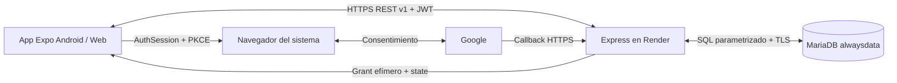

# Arquitectura y decisiones

Express 5 → router → autenticación/rol/validación → controller → service → repository → MariaDB.
Los controllers adaptan HTTP; las reglas viven en services; únicamente repositories
e infraestructura usan SQL parametrizado. Zod rechaza propiedades desconocidas.
`errorHandler` traduce fallos a un contrato uniforme sin exponer consultas ni secretos.

## Autenticación y autorización

Bcrypt 12 para contraseñas de hasta 72 bytes. JWT HS256 con issuer/audience, vencimiento,
usuario, rol, auth_version y familia. Cada solicitud verifica la situación actual en SQL.
Refresh aleatorio de 256 bits: solo su hash SHA-256 se persiste. Rotación con bloqueo de
fila; detectar reuso confirma primero la revocación y después devuelve 401.
Logout revoca toda la familia, incluidos JWT aún no vencidos.

Un Cliente nunca elige su rol al registrarse. Se verifica propiedad del vehículo y turno,
la asignación del empleado y su habilitación de cobro. Admin no puede auto-degradarse,
desactivarse ni eliminarse. Cambios administrativos serializan el conteo de admins.

## Reservas y cobros

Una transacción bloquea la única fila de `configuracion_negocio` antes de comprobar la agenda.
También la usan cambios de estado/asignación y baja/edición de vehículos. Es una exclusión
simple apropiada para un lavadero de capacidad inicial 1; evita carreras entre conexiones.
Para mayor escala puede particionarse por fecha con orden de bloqueos estable; la tabla
`bloqueos_agenda` queda reservada, no interviene en esta versión.

Los intervalos son [inicio, fin): dos turnos consecutivos son válidos. Un barrido de eventos
comprueba el máximo simultáneo, además de impedir solapamientos de empleado y vehículo.
La cotización es informativa: la reserva vuelve a validar horario, capacidad y catálogo.
Precio, nombre y duración contratados se guardan en `servicios_turno`.

El cobro bloquea el turno, verifica saldo y una clave UUID de idempotencia global.
Reintentar la misma operación devuelve su resultado sin duplicar dinero. Los reportes
separan fecha del trabajo y fecha real de pago para evitar sumar ingresos dos veces.

## OAuth

AuthSession genera state y PKCE S256. El backend conserva su propio state de proveedor,
intercambia el código con el secreto y exige email verificado. El retorno móvil contiene
un grant de 60 segundos, de un uso y ligado al PKCE, nunca access tokens en la URL.
Solo se aceptan redirect URIs exactas de una allowlist. Google usa además PKCE en el tramo proveedor. Discord y GitHub se retiraron; sus endpoints devuelven 410. Ningún secreto viaja a Expo.

## Persistencia y despliegue

SQL MariaDB 11.8, claves foráneas, borrado lógico y migraciones con checksum. Fechas UTC;
Luxon traduce el calendario de Buenos Aires. Enteros centavos evitan errores monetarios.
Render mantiene el backend y alwaysdata la persistencia MariaDB con TLS y certificado verificado.
Usuarios distintos para nehuenlavadero_dev/nehuenlavadero_prod, limitados a su propia base.

## Mapa del sistema

