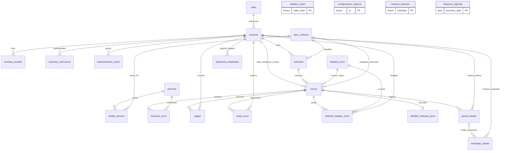

# MariaDB — modelo, diccionario y normalización

Versión objetivo: **MariaDB 11.8**, motor InnoDB, utf8mb4. Tablas y textos UI en español; columnas y códigos conservan su contrato estable.
`BIGINT` se serializará como string en JSON para no superar el entero seguro de JavaScript.
Fechas en UTC, importes en centavos ARS. No se guardan access/refresh tokens legibles.

## Entidades y relaciones

La relación "turno contiene al menos un servicio" se valida en la transacción de creación,
no con una FK inversa. Un turno pendiente puede no tener empleado. Se puede confirmar por categoría antes de cargar un vehículo; la vinculación posterior conserva precio, servicios y horario.

Ver [ubicación de MariaDB, diccionario de las 25 tablas y migración](mariadb.md).

## Formas normales

**1FN:** columnas atómicas. Servicios del turno, cuentas sociales y pagos son filas distintas;
no hay arrays de servicios, listas de días ni columnas servicio1/servicio2 en tablas de negocio.

**2FN:** las tablas puente usan claves compuestas. Precio vigente depende del par
(service_id, vehicle_type_id); precio/duración contratados dependen de (appointment_id, service_id).
Nombres del usuario y tipo de vehículo no se repiten en esas tablas.

**3FN:** roles, estados y tipos tienen catálogos propios. El vehículo referencia al dueño;
el turno referencia al cliente **histórico**. Esta versión no transfiere vehículos entre titulares.
No se almacena total derivado en turnos. Precio, nombre y duración aplicados son hechos del
contrato histórico, no copias del catálogo vigente: no dependen solo del servicio actual.
Se preserva moneda del contrato aunque en el futuro cambie la configuración del negocio.

## Restricciones y límites de responsabilidad

PK/FK, email/patente únicos, provider+subject único, token hash único, precios positivos,
fin posterior al inicio y pagos con idempotencia se garantizan con SQL.
No se hace cascada destructiva de usuarios, vehículos, servicios, turnos ni pagos.
Email y patente permanecen reservados tras el borrado lógico para conservar trazabilidad.

Rol del cliente/equipo, propiedad, último admin, transiciones, duración, total cobrado,
solapamientos y capacidad se garantizan en los servicios transaccionales implementados.
Esta versión usa la fila común de `configuracion_negocio` como mutex de agenda.
`bloqueos_agenda` queda reservada para una futura optimización por fecha; no es el lock activo.
`auth_version` permite invalidar sesiones por cambio de rol/desactivación.

## Scripts

- `database/migrations/001_identity.sql`: roles, usuarios, sociales y refresh.
- `002_catalog.sql`: tipos, vehículos, servicios y precios.
- `003_appointments.sql`: estados, turnos, ítems, notas, historial y pagos.
- `004_settings.sql`: configuración, horarios y locks de agenda.
- `database/schema.sql`: agregado para leer/importar en una base vacía.
- `database/seeds/catalog.sql`: catálogos y ejemplos; administrador creado con bcrypt por `seed.ts`.

Usar **npm run db:migrate** en el despliegue: registra checksum y obtiene lock. Un import SQL
manual no registra versiones; no mezclar ambas vías. El DDL de MariaDB/MySQL tiene commit implícito:
si una migración falla se inspecciona el estado parcial y se corrige con una versión nueva,
nunca se afirma que hubo rollback automático del esquema. El seed DML sí es transaccional.

## Diccionario de columnas

Cada tabla siguiente indica todos sus campos. El SQL es la autoridad sobre longitudes,
índices, nulos, defaults y constraints. `migraciones_esquema` es infraestructura del migrador:
`name` (PK, archivo), `checksum` (SHA-256 inmutable), `applied_at` (UTC de aplicación).

### roles

Catálogo de permisos base.

| Columna | Tipo SQL           | Significado               |
| ------- | ------------------ | ------------------------- |
| `id`    | `TINYINT UNSIGNED` | Identificador primario.   |
| `code`  | `VARCHAR(20)`      | Código estable en inglés. |
| `label` | `VARCHAR(40)`      | Etiqueta en español.      |

### usuarios

Identidad, perfil y estado lógico de la cuenta.

| Columna               | Tipo SQL           | Significado                                           |
| --------------------- | ------------------ | ----------------------------------------------------- |
| `id`                  | `BIGINT UNSIGNED`  | Identificador primario.                               |
| `role_id`             | `TINYINT UNSIGNED` | Rol asignado por administrador.                       |
| `email`               | `VARCHAR(254)`     | Email único normalizado.                              |
| `password_hash`       | `VARCHAR(60)`      | Hash bcrypt o NULL para OAuth.                        |
| `first_name`          | `VARCHAR(80)`      | Nombre.                                               |
| `last_name`           | `VARCHAR(80)`      | Apellido.                                             |
| `phone`               | `VARCHAR(30)`      | Teléfono de contacto.                                 |
| `avatar_url`          | `VARCHAR(2048)`    | URL opcional de foto.                                 |
| `can_record_payments` | `BOOLEAN`          | Habilitación administrativa para cobros de empleados. |
| `is_active`           | `BOOLEAN`          | Disponible/activo sin borrado físico.                 |
| `auth_version`        | `INT UNSIGNED`     | Versión de autorización para invalidar JWT.           |
| `created_at`          | `DATETIME(3)`      | Instante de creación UTC.                             |
| `updated_at`          | `DATETIME(3)`      | Última modificación UTC.                              |
| `deleted_at`          | `DATETIME(3)`      | Fecha UTC de borrado lógico, NULL si no eliminado.    |

### cuentas_sociales

Identidad externa validada por proveedor, sin tokens persistidos.

| Columna            | Tipo SQL          | Significado                                       |
| ------------------ | ----------------- | ------------------------------------------------- |
| `id`               | `BIGINT UNSIGNED` | Identificador primario.                           |
| `user_id`          | `BIGINT UNSIGNED` | Usuario propietario.                              |
| `provider`         | `VARCHAR(16)`     | Google, Discord o GitHub.                         |
| `provider_subject` | `VARCHAR(255)`    | ID estable y sensible a mayúsculas del proveedor. |
| `created_at`       | `DATETIME(3)`     | Instante de creación UTC.                         |

### sesiones_renovacion

Sesiones revocables y familias de rotación.

| Columna          | Tipo SQL          | Significado                          |
| ---------------- | ----------------- | ------------------------------------ |
| `id`             | `BIGINT UNSIGNED` | Identificador primario.              |
| `user_id`        | `BIGINT UNSIGNED` | Usuario propietario.                 |
| `token_hash`     | `BINARY(32)`      | SHA-256 de token opaco, 32 bytes.    |
| `family_id`      | `CHAR(36)`        | UUID de familia para detectar reuso. |
| `expires_at`     | `DATETIME(3)`     | Vencimiento UTC.                     |
| `revoked_at`     | `DATETIME(3)`     | Revocación UTC.                      |
| `replaced_by_id` | `BIGINT UNSIGNED` | Token sucesor de rotación.           |
| `created_at`     | `DATETIME(3)`     | Instante de creación UTC.            |

### tipos_vehiculo

Tipos usados para precios y vehículos.

| Columna     | Tipo SQL            | Significado                           |
| ----------- | ------------------- | ------------------------------------- |
| `id`        | `SMALLINT UNSIGNED` | Identificador primario.               |
| `code`      | `VARCHAR(24)`       | Código estable en inglés.             |
| `name`      | `VARCHAR(80)`       | Nombre descriptivo.                   |
| `is_active` | `BOOLEAN`           | Disponible/activo sin borrado físico. |

### vehiculos

Vehículos con propietario actual y patente única.

| Columna           | Tipo SQL            | Significado                                        |
| ----------------- | ------------------- | -------------------------------------------------- |
| `id`              | `BIGINT UNSIGNED`   | Identificador primario.                            |
| `owner_id`        | `BIGINT UNSIGNED`   | Propietario actual.                                |
| `vehicle_type_id` | `SMALLINT UNSIGNED` | Tipo de vehículo.                                  |
| `plate`           | `VARCHAR(16)`       | Patente única sin diferencia de mayúsculas.        |
| `brand`           | `VARCHAR(80)`       | Marca.                                             |
| `model`           | `VARCHAR(80)`       | Modelo.                                            |
| `color`           | `VARCHAR(50)`       | Color.                                             |
| `created_at`      | `DATETIME(3)`       | Instante de creación UTC.                          |
| `updated_at`      | `DATETIME(3)`       | Última modificación UTC.                           |
| `deleted_at`      | `DATETIME(3)`       | Fecha UTC de borrado lógico, NULL si no eliminado. |

### servicios

Catálogo editable de trabajos.

| Columna            | Tipo SQL            | Significado                                        |
| ------------------ | ------------------- | -------------------------------------------------- |
| `id`               | `BIGINT UNSIGNED`   | Identificador primario.                            |
| `code`             | `VARCHAR(40)`       | Código estable en inglés.                          |
| `name`             | `VARCHAR(100)`      | Nombre descriptivo.                                |
| `description`      | `TEXT`              | Descripción del servicio.                          |
| `duration_minutes` | `SMALLINT UNSIGNED` | Tiempo estimado del servicio.                      |
| `is_active`        | `BOOLEAN`           | Disponible/activo sin borrado físico.              |
| `created_at`       | `DATETIME(3)`       | Instante de creación UTC.                          |
| `updated_at`       | `DATETIME(3)`       | Última modificación UTC.                           |
| `deleted_at`       | `DATETIME(3)`       | Fecha UTC de borrado lógico, NULL si no eliminado. |

### tarifas_servicio

Precio vigente para cada servicio y tipo.

| Columna           | Tipo SQL            | Significado                     |
| ----------------- | ------------------- | ------------------------------- |
| `service_id`      | `BIGINT UNSIGNED`   | Servicio de catálogo.           |
| `vehicle_type_id` | `SMALLINT UNSIGNED` | Tipo de vehículo.               |
| `price_cents`     | `INT UNSIGNED`      | Precio vigente en centavos ARS. |
| `updated_at`      | `DATETIME(3)`       | Última modificación UTC.        |

### estados_turno

Estados admitidos del flujo.

| Columna | Tipo SQL           | Significado               |
| ------- | ------------------ | ------------------------- |
| `id`    | `TINYINT UNSIGNED` | Identificador primario.   |
| `code`  | `VARCHAR(20)`      | Código estable en inglés. |
| `label` | `VARCHAR(40)`      | Etiqueta en español.      |

### turnos

Reserva con fechas, participantes y estado actual.

| Columna                    | Tipo SQL                 | Significado                                                  |
| -------------------------- | ------------------------ | ------------------------------------------------------------ |
| `id`                       | `BIGINT UNSIGNED`        | Identificador primario.                                      |
| `client_id`                | `BIGINT UNSIGNED`        | Cliente titular al reservar.                                 |
| `vehicle_id`               | `BIGINT UNSIGNED NULL`   | Vehículo vinculado; puede agregarse después de confirmar.    |
| `reserved_vehicle_type_id` | `SMALLINT UNSIGNED NULL` | Categoría reservada que conserva la cotización sin vehículo. |
| `employee_id`              | `BIGINT UNSIGNED`        | Responsable interno al iniciar; no limita visibilidad.       |
| `status_id`                | `TINYINT UNSIGNED`       | Estado actual o auditado.                                    |
| `starts_at`                | `DATETIME(3)`            | Inicio UTC del intervalo.                                    |
| `ends_at`                  | `DATETIME(3)`            | Fin UTC exclusivo del intervalo.                             |
| `currency_code`            | `CHAR(3)`                | Código ISO de moneda, ARS en este proyecto.                  |
| `created_by_id`            | `BIGINT UNSIGNED`        | Usuario que creó la reserva.                                 |
| `cancelled_by_id`          | `BIGINT UNSIGNED`        | Usuario que canceló.                                         |
| `cancellation_reason`      | `VARCHAR(500)`           | Motivo de cancelación.                                       |
| `version`                  | `INT UNSIGNED`           | Versión para concurrencia optimista.                         |
| `created_at`               | `DATETIME(3)`            | Instante de creación UTC.                                    |
| `updated_at`               | `DATETIME(3)`            | Última modificación UTC.                                     |

### servicios_turno

Contrato histórico de los servicios seleccionados.

| Columna                    | Tipo SQL            | Significado                    |
| -------------------------- | ------------------- | ------------------------------ |
| `appointment_id`           | `BIGINT UNSIGNED`   | Turno asociado.                |
| `service_id`               | `BIGINT UNSIGNED`   | Servicio de catálogo.          |
| `applied_price_cents`      | `INT UNSIGNED`      | Precio acordado al reservar.   |
| `applied_duration_minutes` | `SMALLINT UNSIGNED` | Duración acordada al reservar. |
| `applied_service_name`     | `VARCHAR(100)`      | Nombre histórico del servicio. |

### notas_turno

Observaciones trazables por autor.

| Columna          | Tipo SQL          | Significado               |
| ---------------- | ----------------- | ------------------------- |
| `id`             | `BIGINT UNSIGNED` | Identificador primario.   |
| `appointment_id` | `BIGINT UNSIGNED` | Turno asociado.           |
| `author_id`      | `BIGINT UNSIGNED` | Autor de observación.     |
| `body`           | `VARCHAR(2000)`   | Contenido de observación. |
| `created_at`     | `DATETIME(3)`     | Instante de creación UTC. |

### historial_estados_turno

Auditoría de cambios de estado.

| Columna          | Tipo SQL           | Significado               |
| ---------------- | ------------------ | ------------------------- |
| `id`             | `BIGINT UNSIGNED`  | Identificador primario.   |
| `appointment_id` | `BIGINT UNSIGNED`  | Turno asociado.           |
| `status_id`      | `TINYINT UNSIGNED` | Estado actual o auditado. |
| `changed_by_id`  | `BIGINT UNSIGNED`  | Actor del cambio.         |
| `created_at`     | `DATETIME(3)`      | Instante de creación UTC. |

### pagos

Cobros con método y clave de reintento idempotente.

| Columna           | Tipo SQL          | Significado                            |
| ----------------- | ----------------- | -------------------------------------- |
| `id`              | `BIGINT UNSIGNED` | Identificador primario.                |
| `appointment_id`  | `BIGINT UNSIGNED` | Turno asociado.                        |
| `recorded_by_id`  | `BIGINT UNSIGNED` | Actor que registró cobro.              |
| `amount_cents`    | `INT UNSIGNED`    | Importe cobrado en centavos.           |
| `method`          | `VARCHAR(16)`     | cash o transfer.                       |
| `reference`       | `VARCHAR(100)`    | Referencia de transferencia opcional.  |
| `idempotency_key` | `CHAR(36)`        | UUID único del intento lógico de pago. |
| `paid_at`         | `DATETIME(3)`     | Instante UTC del cobro.                |

### configuracion_negocio

Parámetros de la única sucursal.

| Columna                       | Tipo SQL            | Significado                                      |
| ----------------------------- | ------------------- | ------------------------------------------------ |
| `id`                          | `TINYINT UNSIGNED`  | Identificador primario.                          |
| `currency_code`               | `CHAR(3)`           | Código ISO de moneda, ARS en este proyecto.      |
| `time_zone`                   | `VARCHAR(80)`       | Zona IANA del horario local.                     |
| `cancellation_notice_minutes` | `SMALLINT UNSIGNED` | Anticipación mínima para cancelación de cliente. |
| `simultaneous_capacity`       | `SMALLINT UNSIGNED` | Máximo de vehículos solapados.                   |
| `slot_step_minutes`           | `SMALLINT UNSIGNED` | Resolución de horarios candidatos.               |
| `updated_at`                  | `DATETIME(3)`       | Última modificación UTC.                         |

### horarios_atencion

Rango local por día abierto, ausencia de fila significa cerrado.

| Columna     | Tipo SQL           | Significado                   |
| ----------- | ------------------ | ----------------------------- |
| `weekday`   | `TINYINT UNSIGNED` | Día ISO, lunes 1 a domingo 7. |
| `opens_at`  | `TIME`             | Apertura local.               |
| `closes_at` | `TIME`             | Cierre local.                 |

### bloqueos_agenda

Reserva para particionar bloqueos por fecha en una futura versión. En 1.0 se bloquea configuracion_negocio.

| Columna         | Tipo SQL      | Significado                                                   |
| --------------- | ------------- | ------------------------------------------------------------- |
| `business_date` | `DATE`        | Fecha local que se bloquea durante reservas/reprogramaciones. |
| `created_at`    | `DATETIME(3)` | Instante de creación UTC.                                     |

## Migración 005: OAuth efímero

`estados_oauth`: state_hash BINARY(32) PK, provider VARCHAR(16), client_state VARCHAR(256),
redirect_uri VARCHAR(2048), client_challenge/provider_verifier VARCHAR(128), expires_at
DATETIME(3) indexado. Se consume al volver del proveedor; no contiene token OAuth.

`autorizaciones_oauth`: code_hash BINARY(32) PK, user_id BIGINT FK usuarios, code_challenge VARCHAR(128),
expires_at DATETIME(3) indexado, consumed_at DATETIME(3) nullable. El código legible solo
viaja por el retorno y se canjea con PKCE. Los estados vencidos se limpian al generar nuevos. Los grants vencidos dejan de ser
válidos por consulta; su purga periódica queda como tarea de mantenimiento, sin cron configurado.

La instalación actual contiene 25 tablas y 17 migraciones aplicadas. Desarrollo escolar y producción usan usuarios limitados a su propia base; ver [MariaDB](mariadb.md).

## Migración 006 — vinculación social protegida

`006_social_link.sql` agrega a `autorizaciones_oauth` las columnas `link_provider` (proveedor
pendiente), `link_subject` (identidad verificada que se vinculará) y `link_attempts`
(contador de intentos de contraseña). CHECK exige proveedor/sujeto juntos. No se
persiste la contraseña ingresada. El grant se bloquea con FOR UPDATE, conserva PKCE
y se consume una sola vez; los intentos fallidos se confirman antes del error HTTP.

`007_social_link_integrity.sql` exige ambos campos no nulos en la segunda rama del CHECK; así un resultado UNKNOWN de SQL no permite pares parciales. La prueba SQL intenta ambas combinaciones incompletas y exige rechazo. [Regla CHECK de MySQL 8.4](https://dev.mysql.com/doc/refman/8.4/en/create-table-check-constraints.html).

La migración 007 agrega un CHECK más estricto con nombre nuevo. Conserva el anterior y no necesita conceder DROP al usuario de la aplicación.

Los checksums nuevos se calculan sobre SQL con saltos LF. También se reconoce el checksum histórico CRLF del mismo contenido, para migraciones aplicadas desde Windows. Cambiar columnas, datos, comentarios u otros caracteres sigue produciendo error. `.gitattributes` fija LF para SQL y una prueba unitaria cubre ambos sistemas y el rechazo de una modificación real.

> Actualización: la decisión posterior del usuario establece agenda compartida. Consultar [shared-agenda.md](shared-agenda.md) para la regla vigente; capturas anteriores documentan su versión original.

## Ampliaciones operativas vigentes

La migración 009 incorpora detalles del vehículo reservado, partes del empleado, mensajes y asistencia; 010 añade los servicios de detalle, 011 permite reservar por categoría antes de cargar el vehículo, 012 incorpora el lavado de moto y 013/014 traducen tablas al español. El [esquema completo](../database/schema.sql) es la referencia exacta de tipos, índices y restricciones; [operación del negocio](work-operations.md) explica permisos y estados.

| Tabla                     | Responsabilidad y referencias                                                                             |
| ------------------------- | --------------------------------------------------------------------------------------------------------- |
| `detalles_vehiculo_turno` | Descripción del vehículo aportada después de reservar; un registro por turno y autor cliente.             |
| `partes_lavado`           | Descripción del trabajo, responsable, fecha de envío, revisor, decisión y motivo; conserva cada revisión. |
| `mensajes_cliente`        | Reclamo o devolución, titular, turno/parte opcional, respuesta y administrador que respondió.             |
| `asistencia_empleados`    | Empleado, día de negocio, llegada, administrador que ficha y nota; evita duplicar llegada del mismo día.  |

`turnos.reserved_vehicle_type_id` conserva la categoría cotizada aun cuando `vehicle_id` sea nulo. La vinculación posterior exige propietario y categoría compatibles. `estados_turno` incluye `awaiting_review`; finalizar requiere aprobación administrativa del parte y horario abierto.

## Avisos de cancelación

La migración 015 agrega `turnos.cancellation_read_at` y su índice. El motivo permanece en `cancellation_reason` y las observaciones en `notas_turno.body`, con autor y fecha. [Flujo, campos, permisos y pruebas](cancellation-notices.md).

La migración 016 incorpora `ingresos_sin_turno` y admite un titular nulo para ingresos presenciales sin cuenta. Patente, contacto y datos del auto se conservan separados del garaje. [Modelo, validaciones y pruebas del panel](admin-panel.md).

La migración 017 agrega limpieza del Inicio y autoría del cierre del empleado. Ver [flujo de cliente y empleado](client-employee-flow.md).
