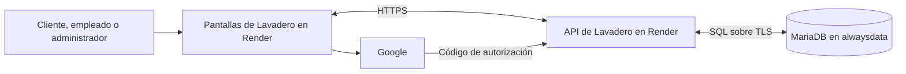

# Cómo funciona Lavadero

## Dónde está cada parte

| Parte                                    | Dónde está                                                                                     | Qué hace                                                                                                                                                                     |
| ---------------------------------------- | ---------------------------------------------------------------------------------------------- | ---------------------------------------------------------------------------------------------------------------------------------------------------------------------------- |
| Página que usan los clientes y el equipo | [Abrir Lavadero](https://lavadero-app-2558.onrender.com/)                                      | Muestra las pantallas, los formularios y la agenda. El código está en `main/frontend`.                                                                                       |
| Servidor                                 | [Servicio `lavadero-api` en Render](https://dashboard.render.com/web/srv-dbht67g473hc7391pajg) | Recibe las solicitudes, verifica permisos, calcula precios y horarios y guarda los cambios. El código está en `main/backend`.                                                |
| Base de datos                            | [Panel de alwaysdata](https://admin.alwaysdata.com/)                                           | MariaDB 11.8 en `mysql-nehuenlavadero.alwaysdata.net:3306`. La página usa `nehuenlavadero_prod`; la escuela usa `nehuenlavadero_dev` con un usuario sin acceso a producción. |
| Código publicado                         | [Proyecto completo en GitHub](https://github.com/nehuenparrondo/lavadero-app)                  | Un repositorio privado contiene las carpetas `frontend` y `backend`. Render toma la rama `main` y publica cada carpeta en su servicio.                                       |
| Contrato de la API                       | [Swagger](https://lavadero-api-48m4.onrender.com/api/docs/)                                    | Lista las solicitudes disponibles, qué datos piden y qué devuelven.                                                                                                          |

Cuando confirmás un turno, la pantalla envía una solicitud a la API. La API verifica la cuenta y las reglas del lavadero, escribe en MariaDB y devuelve el resultado. La página muestra ese resultado. El archivo [`schema.sql`](https://github.com/nehuenparrondo/lavadero-app/blob/main/backend/database/schema.sql) describe la estructura de la base y los datos actuales viven en MariaDB de alwaysdata. La conexión se configura en **Environment** del servicio de Render mediante `DATABASE_URL` y el certificado TLS. El código que abre la conexión está en [`database.ts`](https://github.com/nehuenparrondo/lavadero-app/blob/main/backend/src/config/database.ts).

## Qué puede hacer cada persona

| Rol           | Recorrido habitual                                                                                                                                                                                                                                     |
| ------------- | ------------------------------------------------------------------------------------------------------------------------------------------------------------------------------------------------------------------------------------------------------ |
| Cliente       | Crea una cuenta o ingresa, registra su auto en **Mis vehículos**, consulta **Servicios**, reserva y sigue sus turnos en **Mis turnos**. Puede cancelar según el plazo configurado y consultar el comprobante de un lavado finalizado.                  |
| Empleado      | Abre **Mi agenda**, elige la fecha y ve los trabajos de todo el equipo. El responsable puede comenzar el lavado, dejar observaciones y enviarlo a verificación en horario de atención. Puede registrar un pago si el administrador le dio ese permiso. |
| Administrador | Gestiona usuarios y permisos, vehículos, turnos, catálogo, tarifas y horarios. Puede hacer una reserva para un cliente y consultar los reportes del negocio.                                                                                           |

El nombre o el avatar abre el perfil del usuario. El botón flotante cambia el tema claro u oscuro y el botón de volver arriba aparece al desplazarse en contenido largo. La navegación está en [`roleNavigation.ts`](https://github.com/nehuenparrondo/lavadero-app/blob/main/frontend/src/constants/roleNavigation.ts) y el recorrido por rol tiene capturas en el [manual de usuario](https://github.com/nehuenparrondo/lavadero-app/blob/main/frontend/docs/user-manual.md).

## Cómo funcionan los ingresos

**Con correo y contraseña.** El formulario envía los datos por HTTPS a `/api/v1/auth/login`. El servidor busca el correo, verifica que la cuenta esté activa y compara la contraseña con el hash bcrypt guardado en `usuarios`. Si coincide, devuelve el perfil, el rol y una sesión de Lavadero. Las cuentas nuevas que se crean desde el registro público reciben el rol Cliente. Los roles de empleado y administrador se gestionan con permisos administrativos. [Servicio de autenticación](https://github.com/nehuenparrondo/lavadero-app/blob/main/backend/src/modules/auth/auth.service.ts)

**Con Google, Discord o GitHub.** El botón abre el sitio oficial. Google y GitHub solicitan selección de cuenta (`prompt=select_account`); Discord solicita consentimiento y permite cambiar mediante «¿No eres tú?». También se puede ingresar con correo y contraseña o recuperar el acceso con Mailtrap Sandbox.

El proveedor devuelve un código a la API. La API comprueba que el retorno pertenezca a una solicitud vigente, canjea el código con el proveedor y valida la identidad y el correo. Luego emite un código breve y de un solo uso para que la app obtenga su propia sesión. El identificador del proveedor se guarda en `cuentas_sociales`. Cuando el correo coincide con una cuenta local que ya tiene contraseña, Lavadero pide comprobar esa contraseña antes de vincularla. La contraseña de Google se escribe en la página de ese proveedor. [Flujo social del servidor](https://github.com/nehuenparrondo/lavadero-app/blob/main/backend/src/modules/auth/oauth.service.ts) · [Vinculación](https://github.com/nehuenparrondo/lavadero-app/blob/main/backend/src/modules/auth/oauth.identity.service.ts) · [Botones en la app](https://github.com/nehuenparrondo/lavadero-app/blob/main/frontend/src/components/organisms/SocialLoginButton.tsx)

**Cómo se mantiene la sesión.** El token de acceso permite hacer solicitudes durante un tiempo corto. El token de renovación se guarda en el almacenamiento de la pestaña web o en el almacenamiento seguro de la app instalada. Al cerrar sesión se revoca la familia de tokens. La API comprueba rol y acceso en cada solicitud, incluso cuando la pantalla ya ocultó un botón. [Sesiones de la API](https://github.com/nehuenparrondo/lavadero-app/blob/main/backend/src/modules/auth/session.service.ts) · [Estado de la app](https://github.com/nehuenparrondo/lavadero-app/blob/main/frontend/docs/state.md)

## Cómo se agenda y se atiende un turno

1. El cliente elige la categoría en **Reservar turno**. Esa categoría determina las tarifas disponibles.
2. Elige un solo lavado base, los extras opcionales y la fecha. Los horarios disponibles se eligen con la rueda, arrastrando o usando Anterior/Siguiente. La API suma precios y duraciones y devuelve los inicios que caben en la jornada y tienen cupo. En Moto solo aparece **Lavado** por $15.000.
3. Al tocar **Confirmar reserva**, la API verifica otra vez el titular, el horario, los servicios y la capacidad. La confirmación y el guardado suceden en una transacción. Si dos personas intentan ocupar el último cupo a la vez, el servidor conserva una sola reserva y la otra persona debe elegir otro horario.
4. El turno queda confirmado y entra en la agenda compartida. Se asigna automáticamente un empleado activo disponible. El cliente ve el nombre y el aviso de turno confirmado. Solo el cliente titular completa la patente y los datos o vincula un vehículo propio de la categoría que eligió al reservar. Luego puede guardar la descripción antes del inicio. Administración y empleados ven los datos pendientes o la información ya cargada; no reciben el formulario del cliente. Confirmar un pendiente histórico no exige cargar el vehículo. El equipo encuentra el turno por fecha o patente.
5. El responsable pulsa **Enviar a verificación** y describe lo que hizo. Administración inspecciona el auto, aprueba en horario de atención o devuelve el trabajo con un motivo. Solo la aprobación cambia a Finalizado y habilita el comprobante y la devolución del cliente.

La configuración inicial es de lunes a sábado, de 09:30 a 21:30, en la zona `America/Argentina/Buenos_Aires`, con capacidad para un auto a la vez. La grilla de cinco minutos indica cada cuánto se ofrecen posibles inicios. Interior dura 30 minutos, exterior 35 y completo 40 según el catálogo inicial. El administrador puede ajustar la operación en **Configuración**. [Pantalla de reserva](https://github.com/nehuenparrondo/lavadero-app/blob/main/frontend/src/screens/client/BookingScreen.tsx) · [Disponibilidad](https://github.com/nehuenparrondo/lavadero-app/blob/main/backend/src/modules/appointments/availability.service.ts) · [Guardado de reserva](https://github.com/nehuenparrondo/lavadero-app/blob/main/backend/src/modules/appointments/booking.service.ts) · [Regla de horario](https://github.com/nehuenparrondo/lavadero-app/blob/main/backend/src/modules/appointments/schedule.ts)

La reserva actualiza su disponibilidad automáticamente cada 10 segundos; las agendas y bandejas, cada 15 segundos mientras están visibles. El refresco conserva formularios y filtros sin agregar botones Actualizar. En Administración, Lavados pendientes muestra primero las solicitudes más recientes, incluso para fechas futuras. Los filtros rápidos ofrecen Hoy, Todas las fechas, Nuevas solicitudes; los filtros avanzados permiten buscar cliente, empleado y estado.

## Tarifas, cobros y reportes

| Vehículo  | Interior | Exterior | Completo |
| --------- | -------: | -------: | -------: |
| Auto      |  $15.000 |  $15.000 |  $28.000 |
| Camioneta |  $20.000 |  $20.000 |  $44.000 |
| SUV       |  $17.000 |  $17.000 |  $34.000 |

Los importes están en pesos argentinos. MariaDB guarda centavos enteros, así que $15.000 son `1500000`. Para cambiar tarifas desde la página, entrá como administrador en **Servicios y precios** y editá el importe por tipo de vehículo. Las reservas ya confirmadas conservan el precio, el nombre y la duración que se guardaron al reservar. [Migración de estas tarifas](https://github.com/nehuenparrondo/lavadero-app/blob/main/backend/database/migrations/008_wash_prices.sql) · [Edición de precios](https://github.com/nehuenparrondo/lavadero-app/blob/main/frontend/src/components/organisms/ServicePriceDialog.tsx)

El cobro registra dinero recibido en efectivo o por transferencia. Antes de guardar, la API comprueba el permiso y el saldo. Cada envío tiene una clave única para que reintentar el mismo cobro no lo duplique. En **Reportes**, los lavados se agrupan por su fecha de atención y los ingresos por la fecha en que se registró cada pago. El comprobante reúne el servicio y los cobros del turno. [Lógica de cobros](https://github.com/nehuenparrondo/lavadero-app/blob/main/backend/src/modules/payments/payments.service.ts) · [Reportes](https://github.com/nehuenparrondo/lavadero-app/blob/main/backend/src/modules/reports/reports.service.ts)

## Qué buscar en la base de datos

| Tabla                                                          | Contenido                                                                                      |
| -------------------------------------------------------------- | ---------------------------------------------------------------------------------------------- |
| `usuarios`, `roles`, `cuentas_sociales`, `sesiones_renovacion` | Personas, permisos, cuentas externas vinculadas y sesiones renovables.                         |
| `vehiculos`, `tipos_vehiculo`, `servicios`, `tarifas_servicio` | Vehículos de cada cliente, categorías, servicios y tarifas vigentes.                           |
| `turnos`, `servicios_turno`                                    | Datos del turno y copia de los servicios y precios que el cliente contrató.                    |
| `historial_estados_turno`, `notas_turno`, `pagos`              | Quién cambió cada estado, observaciones y cobros registrados.                                  |
| `configuracion_negocio`, `horarios_atencion`                   | Zona horaria, capacidad, plazo de cancelación y horario de cada día.                           |
| `estados_oauth`, `autorizaciones_oauth`, `schema_migrations`   | Solicitudes sociales temporales, códigos de acceso de un uso y registro de cambios de la base. |

En el panel de alwaysdata se administra el servicio. Para consultar filas, usá DBeaver con el controlador MariaDB, el acceso escolar y TLS verificado. El diccionario completo incluye 25 tablas españolas; la copia anterior en Aiven quedó como respaldo. Para cambiar datos del negocio, usá las pantallas administrativas: aplican las validaciones del servidor y conservan el historial correspondiente. [Modelo y columnas de la base](https://github.com/nehuenparrondo/lavadero-app/blob/main/backend/docs/database.md)

## Dónde editar y cómo publicar

- **Pantallas y navegación.** En `frontend/src/app` están las rutas. `src/screens` arma las páginas, `src/components` contiene las piezas visuales, `src/hooks` coordina el flujo y `src/api/services` realiza las llamadas al servidor. [Guía del código de la app](https://github.com/nehuenparrondo/lavadero-app/blob/main/frontend/docs/code-guide.md)
- **Reglas de negocio.** En `backend/src/modules`, cada módulo separa rutas, validación, lógica y consultas SQL. Los módulos `auth`, `turnos`, `servicios`, `settings`, `pagos` y `reports` cubren las operaciones principales. [Guía del código del servidor](https://github.com/nehuenparrondo/lavadero-app/blob/main/backend/docs/code-guide.md)
- **Cambios de base.** Los archivos en `main/backend/database/migrations` se aplican en orden. Render ejecuta las migraciones de la API al arrancar y MariaDB registra cuáles se aplicaron. `database/seeds` sirve para cargar el catálogo y la configuración inicial en una instalación nueva. [Migraciones](https://github.com/nehuenparrondo/lavadero-app/blob/main/backend/database/migrations/README.md)
- **Publicación y diagnóstico.** La app y la API se publican como servicios separados. Los cambios de la rama `main` disparan sus despliegues en Render. Si la app abre pero tarda en conectar, `/ready` indica si la API logra conectarse a MariaDB. El panel de Render muestra los registros de arranque y despliegue. [Estado de la API](https://lavadero-api-48m4.onrender.com/ready) · [Guía de hosting](https://github.com/nehuenparrondo/lavadero-app/blob/main/backend/docs/hosting.md)
- **Trabajo local y demostración.** Abrí `main` en VS Code. Ejecutá `npm run install:all` y luego `npm run dev` desde esa carpeta para iniciar ambas partes. El navegador de desarrollo requiere que su origen esté permitido por la API de desarrollo para completar ingresos y reservas. Para probar el sistema publicado en iPhone, abrí la página en Safari y elegí la cuenta de demostración según el rol. [Instalación de la app](https://github.com/nehuenparrondo/lavadero-app/blob/main/frontend/docs/installation.md) · [Instalación de la API](https://github.com/nehuenparrondo/lavadero-app/blob/main/backend/docs/installation.md) · [Accesos privados](https://lavadero-app-2558.onrender.com/sign-in)

## Atención, verificación y asistencia

El cliente puede reclamar desde Inicio y enviar una devolución desde un turno verificado. Administración consulta y responde esos mensajes en su bandeja. La devolución se liga al parte que registró el responsable, con su nombre y descripción del trabajo. En Asistencia, un administrador ficha la primera llegada de cada empleado y puede consultar otros días. [Flujo y archivos](https://github.com/nehuenparrondo/lavadero-app/blob/main/backend/docs/work-operations.md)

La base operativa es MariaDB en alwaysdata. Para abrir desarrollo con DBeaver, seguí la [guía del gestor SQL](mariadb.md). Ver [ubicación, migraciones y las 27 tablas](https://github.com/nehuenparrondo/lavadero-app/blob/main/backend/docs/mariadb.md).

## Cancelaciones visibles en Inicio

El cliente recibe avisos persistentes con fecha, vehículo y motivo. Entendido guarda la lectura en MariaDB sin borrar la cancelación. Las observaciones conservan texto completo, autor y fecha; consultar cambios no descarta borradores. Ver [campos, rutas y pruebas](cancellation-notices.md).

Ver [panel administrativo actualizado: ingreso presencial, cuentas, asistencia y semanas](admin-panel.md).
