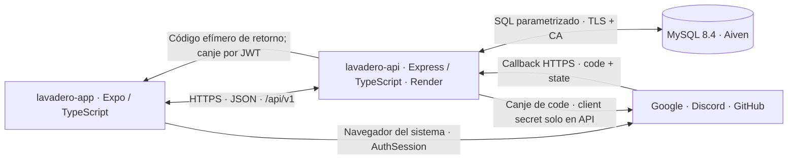

# Arquitectura

El diagrama describe el sistema objetivo. En la etapa 1 solo se ejecutan salud, readiness,
Swagger y pantalla inicial. No hay autenticación, roles ni rutas CRUD activas.

## Separación y flujo

Cada raíz tiene package.json, lockfile, tsconfig, lint, entorno, documentación, CI y Git propios.
La app puede instalarse y probarse sola; la API puede consumirse con Postman/Swagger.
No hay imports ni directorio compartido entre ambos proyectos.

Backend: rutas → validación/middlewares → controller → service → repository → MySQL.
Controllers adaptan HTTP; services deciden reglas; repositories contienen SQL y transacciones.
Herramientas database/ son infraestructura separada de las peticiones de negocio.

Frontend: pantalla → hook → api/services → cliente HTTP. Componentes atómicos reciben props.
Context administra sesión/tema; tipos propios se ajustan al OpenAPI versionado, sin importar la API.

## Integridad y seguridad previstas

- Registro y primer OAuth crean Cliente; ningún body público acepta rol administrativo.
- JWT corto + refresh rotado y revocable en hash. Auth verifica usuario activo/rol actual,
  no confía indefinidamente en permisos antiguos del JWT; auth_version invalida cambios.
- Ownership se aplica dentro de la consulta, además de role guards. Empleado consulta solo asignados.
- Cambio de último administrador bloquea una fila común de roles y cuenta admins activos en transacción;
  evita carreras entre dos degradaciones. No basta con COUNT antes de actualizar.
- Reservar bloquea `booking_day_locks` de cada fecha afectada y comprueba todos los intervalos
  solapados con el nuevo turno (evento de inicio/fin), capacidad y empleado. Reasignaciones,
  cancelaciones y reprogramaciones usan el mismo protocolo y orden de locks.
- Un empleado no puede saltar estados: confirmado → en proceso → finalizado. Cliente cancela
  solo pendiente/confirmado antes de la ventana configurable. Cualquier transición inválida: 409.
  Admin puede solicitar estados distintos, respetando invariantes de asignación/capacidad y auditoría.
- Total histórico = SUM(applied_price_cents). Duración histórica se copia al reservar.
  Pagos usan idempotency_key; suma cobrada no supera total, controlada bajo lock del turno.
- OAuth vincula por email **verificado por el proveedor**; si no está verificado o no está presente,
  se solicita prueba de control/inicio de sesión antes de vincular. Evita tomar cuentas ajenas.
  Usar state de un solo uso, PKCE y allowlist de callbacks; nunca JWT en query de deep link.

Estas reglas son criterios de implementación y pruebas de etapas 3–8; el esquema por sí solo
no implementa permisos, transiciones, capacidad ni protección del último admin.

## Decisiones

SQL directo permite justificar normalización y bloqueo. Centavos enteros evitan redondeos binarios.
UTC en las columnas temporales y zona IANA en configuración evitan depender de la zona del servidor.
Errores centralizados exponen solo mensaje público y código estable. CORS es una política del
navegador; la autenticación/autoridad de permisos siempre corresponde al backend.
