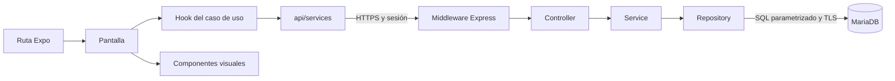
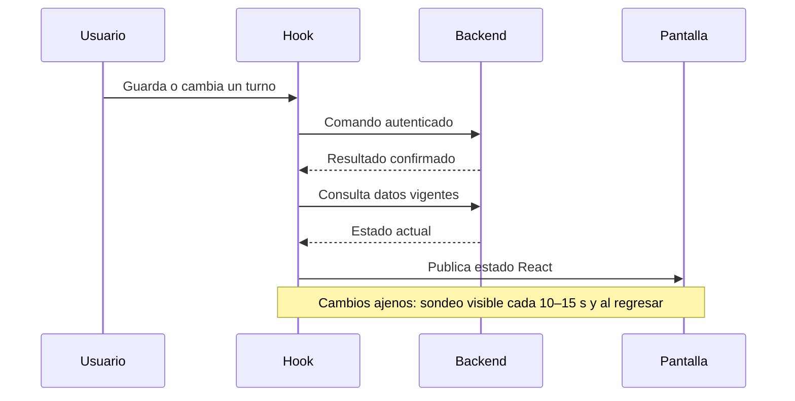

# Arquitectura y recorridos del código

## Separación de responsabilidades

| Capa                 | Qué contiene                                                                | Dónde buscar                                                    |
| -------------------- | --------------------------------------------------------------------------- | --------------------------------------------------------------- |
| Rutas y guardas      | Montaje de pantallas y acceso según sesión/rol.                             | `frontend/src/app`, `navigation`, `constants/roleNavigation.ts` |
| Pantallas            | Composición del recorrido y conexión con su hook.                           | `frontend/src/screens/{client,employee,admin,auth}`             |
| Componentes          | Botones/campos, tarjetas y bloques de una tarea; datos y callbacks tipados. | `frontend/src/components/{atoms,molecules,organisms}`           |
| Hooks                | Selección, filtros, consultas, comandos y mensajes de error.                | `frontend/src/hooks`                                            |
| Transporte           | DTOs, solicitudes HTTP, sesión y renovación.                                | `frontend/src/api` y `api/services`                             |
| Frontera HTTP        | Rutas, autenticación, roles, validación Zod y contrato de errores.          | `backend/src/routes.ts`, `middlewares`, `errors`                |
| Dominio              | Reglas, propiedad de recursos, transacciones y proyección por rol.          | `backend/src/modules/*/*.service.ts`, archivos access/presenter |
| Persistencia         | Consultas parametrizadas, mapeo de filas y escrituras.                      | `backend/src/modules/*/*.repository.ts`, `utils/db.ts`          |
| Esquema              | Migraciones, checksums, semillas y adaptación MariaDB.                      | `backend/database`                                              |
| Herramientas comunes | Arranque conjunto, auditoría y documentación.                               | `scripts` en la raíz                                            |

Un controller convierte una solicitud validada en una llamada al servicio; no importa repositorios. El servicio define el alcance del actor antes de consultar. El repositorio no recibe un ID como prueba de autorización. La UI usa hooks y servicios de red; no hace `fetch` ni Axios directamente en pantallas/componentes. Los tipos del frontend se mantienen independientes del backend para no empaquetar código privado en la app.

## Arranque

`backend/src/app.ts` compone Express sin abrir un puerto, lo que permite probar la app con Supertest. `server.ts` escucha el puerto, instala el cierre y el trabajador de correo; `routes.ts` monta la API versionada. `/health` comprueba proceso y `/ready` consulta la base.

`frontend/src/app/_layout.tsx` compone proveedores y navegación. AuthContext restaura la sesión sin desmontar repetidamente las rutas; ThemeContext conserva la preferencia visual. `scripts/dev.mjs` inicia ambos procesos con puertos comprobados y URL local explícita. `development-env.mjs` exige una base terminada en `_dev` y deshabilita Google local para no mezclar retornos de producción.

## Acceso y sesión

El registro público asigna Cliente. El login busca una cuenta activa y compara bcrypt; no guarda contraseñas legibles. El servidor emite access JWT corto y refresh opaco. Solo el hash del refresh se persiste. La rotación bloquea la fila y conserva la revocación de la familia ante reutilización. Los rechazos que deben confirmar una revocación se emiten después del commit.

El frontend guarda el access/perfil en memoria y el refresh en el almacenamiento de la plataforma; en web dura la pestaña mediante sessionStorage. El interceptor comparte una renovación en curso y reintenta una sola vez. Un fallo de red no equivale a una sesión rechazada. La API vuelve a comprobar identidad vigente y permisos en cada solicitud.

Google es el único proveedor social habilitable. El navegador comparte código/state y el backend usa su secreto para canjearlo. La app consume un grant efímero con PKCE. Si coincide el correo de una cuenta local, exige comprobar su contraseña antes de vincular. Discord/GitHub permanecen retirados. La recuperación con Mailtrap Sandbox usa tokens de un uso con expiración y una cola persistente; los mensajes se capturan en la bandeja de pruebas.

## Reserva y disponibilidad

1. `useBookingSelection` conserva categoría, servicio base, extras, fecha y horario. La fecha comienza sin seleccionar. Cambiar una selección relevante invalida el horario anterior.
2. `useBookingResources` consulta catálogo y disponibilidad. El backend cotiza en centavos y minutos; la interfaz no envía un precio como autoridad.
3. `schedule.ts` interpreta el calendario del negocio y convierte a UTC. `intervals.ts` y `teamCapacity.ts` y los servicios de agenda comprueban intervalos `[inicio, fin)`, capacidad y ocupación.
4. Al confirmar, `booking.service.ts` toma el bloqueo de `configuracion_negocio`, recotiza y comprueba otra vez el horario. Dos solicitudes no pueden confirmar el mismo inicio. Una consulta previa no reserva lugar.
5. Se guardan turno confirmado, servicios históricos, importes/duraciones y estado en una transacción. La asignación automática intenta elegir un empleado activo libre; el equipo ve la agenda compartida y los permisos de trabajo controlan quién puede operarlo.
6. El cliente agrega patente/vehículo después de confirmar. `attachVehicle.service.ts` valida titularidad, categoría y compatibilidad con el contrato existente. Un ingreso presencial se guarda en `ingresos_sin_turno` sin exigir garaje.

El catálogo admite un único lavado base. Cera/tapizados son extras; Moto ofrece su lavado específico. Las restricciones las valida la API aunque la UI haya ocultado una opción. Los cambios posteriores de tarifa no reescriben el contrato de visitas anteriores.

## Actualización automática y errores

`useQuery` identifica cada recurso por filtros y generación. `queryRequest.ts` descarta respuestas tardías y `queryLifecycle.ts` conserva datos del mismo filtro durante una consulta silenciosa. Al cambiar filtros no muestra datos de otra selección. `useRefreshOnReturn` y `refreshGate` evitan solicitudes superpuestas, pausan el sondeo con la pantalla oculta y consultan al volver. No requieren F5 ni botones de actualización.

`useAction` separa errores de escritura de la colección leída. Devuelve `undefined` si la operación falla; solo después de un resultado confirmado se cierra un diálogo, navega o cambia una clave de idempotencia. El servidor es la fuente de verdad y también resuelve carreras ocurridas entre una consulta y el envío.

## Trabajo, cobro y cierre

La agenda del empleado muestra pendientes de hoy; las otras fechas se consultan en historial. La responsabilidad se toma/valida en los servicios del turno, bajo bloqueo. `payments.service.ts` comprueba habilitación, estado y saldo. El UUID identifica una intención de cobro: repetirla no duplica dinero y reutilizarlo para otro importe falla.

El cierre actual usa `paidFinish.service.ts`: exige responsable autorizado, cobro completo y horario/día laboral. Guarda parte, autor y estado finalizado sin revisión obligatoria del administrador. El flujo `wash.service.ts` conserva revisión/devolución para compatibilidad con partes anteriores y sus rutas. Los lavados finalizados pueden recibir una devolución del cliente ligada al parte y su responsable.

La cancelación exige motivo persistente, autor e historial. Los avisos de `cancellation-notices` llegan al Inicio del cliente y se confirman leídos en la base. Limpiar tarjetas del Inicio oculta su presentación para ese cliente; no borra turnos, pagos ni auditoría.

## Otros dominios

| Dominio                 | Responsabilidad e invariante principal                                                                                 |
| ----------------------- | ---------------------------------------------------------------------------------------------------------------------- |
| Usuarios                | Alta administrativa de clientes/empleados; edición sin cambiar rol; bajas lógicas y revocación de sesiones.            |
| Vehículos               | Patente normalizada, titular autorizado y baja sin borrar historial; no transferir un vehículo histórico a otro dueño. |
| Tipos/servicios/tarifas | Catálogos activos, precios por categoría y conservación del contrato reservado.                                        |
| Mensajes                | Reclamos persistentes, devoluciones únicas por parte y respuesta administrativa visible al titular.                    |
| Asistencia              | Administrador registra llegada observada solo hoy y en horario/día laboral; prevalece el primer fichaje.               |
| Reportes                | Importes por fecha real del pago y lavados por fecha de trabajo; semanas, servicios y períodos del calendario local.   |
| Configuración           | Zona, moneda, capacidad, días, horario, paso de agenda y anticipación; cambios serializados con reservas.              |

## Reglas que conviene conservar al modificar

- Fechas persistidas en UTC; calendario y horarios en la zona IANA del negocio.
- IDs SQL grandes como strings en JSON; dinero como centavos enteros ARS.
- SQL con parámetros, identificadores dinámicos restringidos y errores públicos sin consultas ni secretos.
- Bloqueos en el mismo orden y una conexión/executor para todas las escrituras de una transacción.
- Motivos, observaciones, pagos y partes persistidos con trazabilidad; una baja visual no sustituye el historial.
- Verificación de rol/propiedad en servidor, aunque la pantalla ya limite los controles.

Los índices [backend](../backend/docs/source-map.md) y [frontend](../frontend/docs/source-map.md) enlazan cada función pública y sus parámetros con su archivo real.
