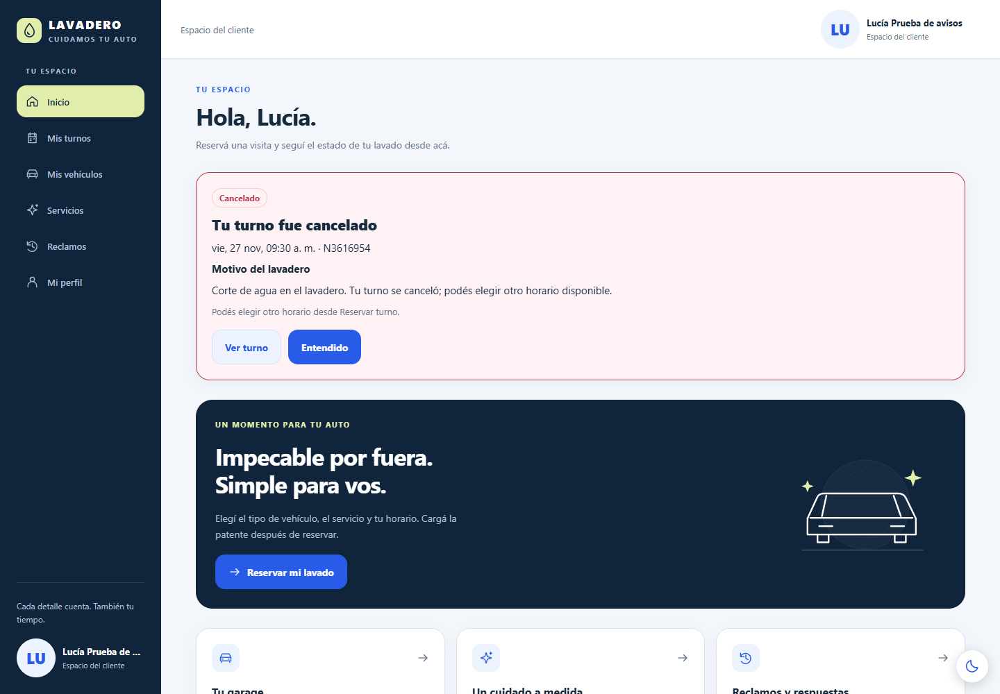
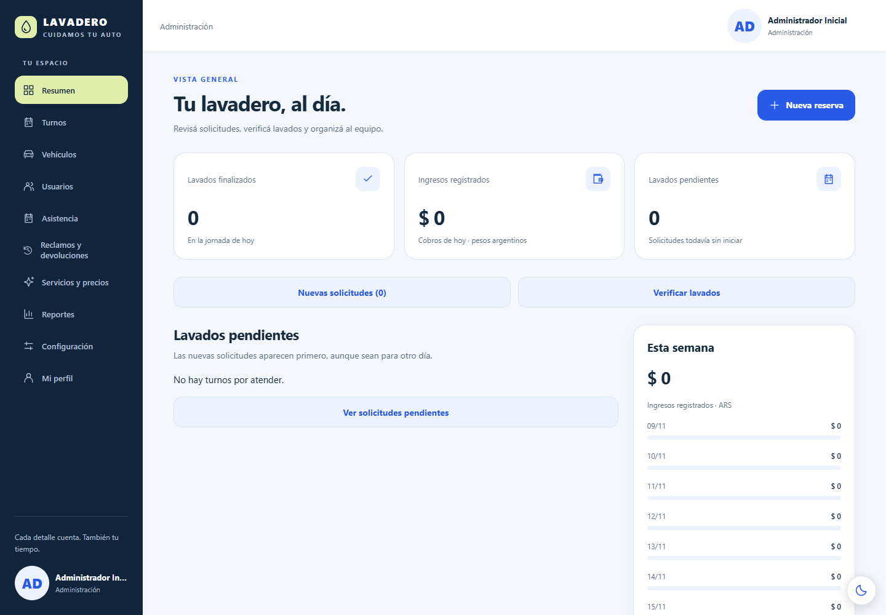
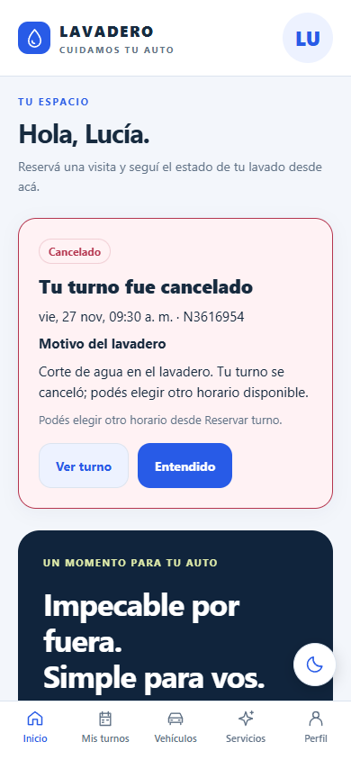
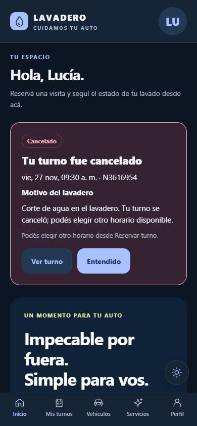

# Ajustes visuales y avisos en Inicio

Se mantienen las rutas, menús, distribución por rol y pasos de reserva. La mejora compartida ajusta superficies, bordes, sombras discretas, tamaños táctiles, campos con foco visible y estados de error. Los cambios llegan a Cliente, Empleado y Administración a través de los componentes comunes, sin duplicar pantallas.

Los campos de texto largo tienen contador, etiquetas claras y espacio para leer lo escrito. Un motivo vacío o compuesto solo por espacios se rechaza. Las observaciones muestran texto completo, autor y fecha. El borrador no se pierde al consultar cambios de otro empleado y solo se limpia después de guardarse correctamente.

Cuando el lavadero cancela una reserva, Inicio muestra el aviso antes de la invitación a reservar. Incluye fecha, vehículo y el motivo completo. Ver turno conserva el aviso; Entendido guarda su lectura en la base. El detalle sigue mostrando el motivo después de leerlo. La actualización ocurre cada 15 segundos mientras Inicio está visible y al volver a la pantalla.

La paleta mantiene la identidad azul y la navegación existente, con colores semánticos para cancelaciones en ambos temas. Los controles siguen siendo compatibles con Expo 58 y React Native 0.88, sin nuevas dependencias nativas. La revisión visual utiliza navegador de escritorio y tamaño de teléfono; no acredita una ejecución física en iPhone.

## Dónde está la información

El backend guarda el motivo en `turnos.cancellation_reason`, su autor en `cancelled_by_id` y la lectura en `cancellation_read_at`. Las observaciones viven en `notas_turno.body`, con autor y fecha. Son datos del servidor y se conservan al cerrar sesión. Ver [persistencia, permisos y pruebas](https://github.com/nehuenparrondo/lavadero-api/blob/main/docs/cancellation-notices.md).

## Referencias de plataforma

- [Expo SDK 58](https://docs.expo.dev/versions/v58.0.0/)
- [TextInput de React Native](https://reactnative.dev/docs/textinput)
- [Sombras y contorno de foco](https://reactnative.dev/docs/view-style-props)

## Capturas de la revisión

Las capturas usan cuentas de prueba y la base escolar, sin cancelar turnos reales.

