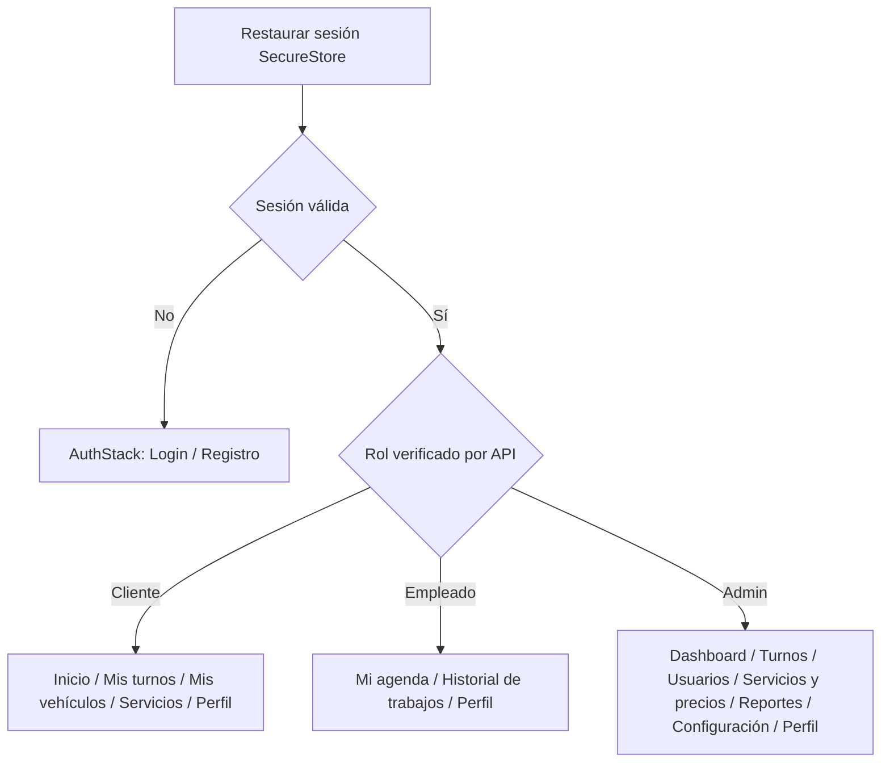

# Navegación

**Etapa 1:** BootstrapScreen es la única pantalla. A continuación, diseño de etapa 6/7.
Expo Router con parámetros TypeScript propios y reconstrucción del árbol al cambiar sesión/rol.

No elegir rol en registro. Deep links y pantallas consultan guardas de sesión y rol.
Cliente ve recursos propios, empleado asignados y administrador los autorizados por API.
La navegación no reemplaza autorización del servidor. Mostrar carga mientras se verifica refresh.
