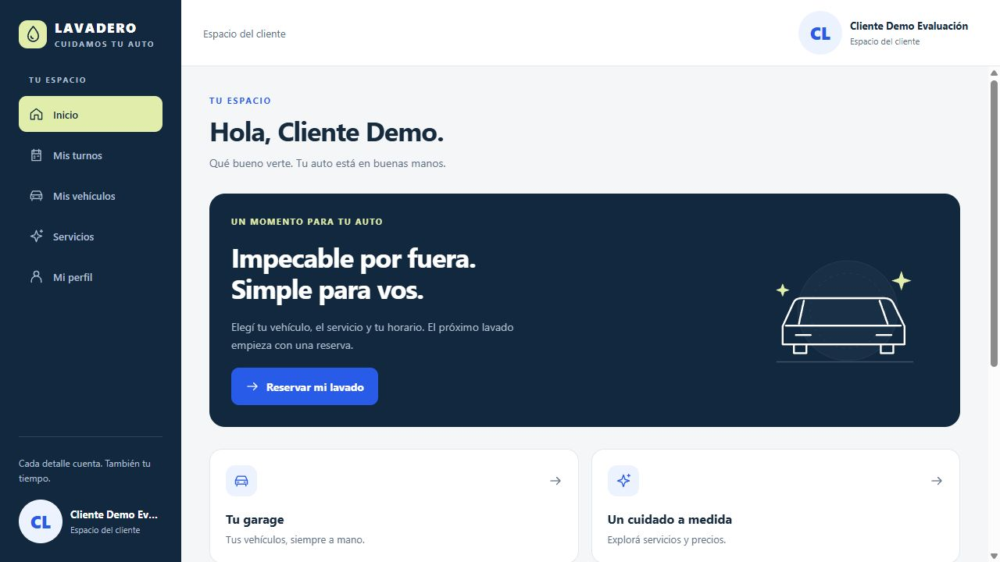
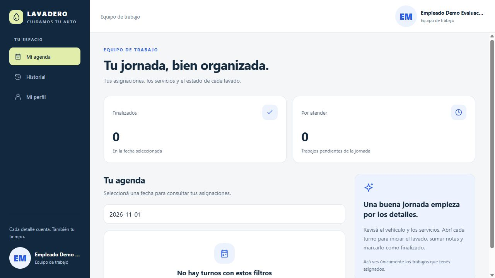
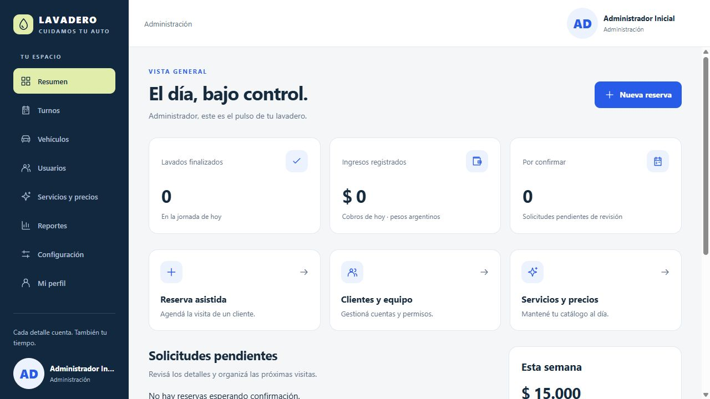

# Rediseño y documentación — Lavadero 1.1

La actualización cubre Cliente, Empleado y Administrador. El servidor conserva
sus reglas de autorización, reservas y cobros.

## Código documentado y modular

- Guías de mantenimiento con recorridos, precondiciones, efectos, errores e invariantes.
- TSDoc público precisado: sesión, PKCE, vinculación, capacidad, transacciones e idempotencia.
- Mapa de los 111 archivos backend y 259 frontend, con exportaciones y responsabilidad.
- README actualizados en 39 carpetas; catálogo de 117 componentes con props y ejemplos.
- Control de fuente: archivos de src de hasta 149 líneas, cuerpos de hasta 30,
  contratos públicos documentados y sin ciclos, incluso entre imports de tipos.
- Pantallas, datos, selección, acciones, presentación y estilos separados.
- Herramientas docs:source y docs:components para regenerar mapas y catálogo.

No se cambió la lógica ejecutable de producción del backend: se comparó el
JavaScript emitido sin comentarios contra la versión anterior y resultó idéntico.

## Las tres experiencias

Cliente: bienvenida personalizada, reserva principal, garage, catálogo y próximas visitas.
Empleado: portada propia, resumen de la fecha consultada, agenda asignada e historial.
Administrador: indicadores diarios, pendientes globales, actividad semanal y accesos de gestión.

La navegación usa barra lateral en escritorio, tabs en móvil para Cliente/Empleado
y menú completo para Administración. Colores, tipografía, superficies, botones,
íconos SVG y tarjetas forman un sistema común. Se mantienen temas claro/oscuro/sistema.
La interfaz no inventa ingresos o tendencias para llenar estados vacíos.

### Cliente

[Vista móvil](images/diseno-cliente-movil.png) · [Tema oscuro](images/diseno-cliente-escritorio-oscuro.png)

### Empleado

[Vista móvil](images/diseno-empleado-movil.png)

### Administrador

[Vista móvil](images/diseno-admin-movil.png) · [Menú móvil](images/diseno-admin-menu-movil.png) · [Orientación horizontal](images/diseno-admin-paisaje.png)

## Verificación de esta actualización

- Tipos estrictos, lint sin advertencias y auditoría de fuente en ambos proyectos.
- 18 pruebas repetidas: 15 de API y 3 de frontend.
- Exportaciones web y Android aprobadas.
- Expo 58.0.22 y sus parches compatibles: expo-doctor 20/20.
- Ingreso local real de Cliente/Empleado/Administrador en la web publicada.
- Revisión a 1280 × 720 y 390 × 844, sin desbordamiento horizontal.
- Administración también comprobada a 844 × 390 en orientación horizontal.
- Tema claro/oscuro, acceso a vehículos y formulario de reserva.
- Historial del empleado con su único trabajo asignado; no muestra el turno cancelado sin asignación.
- Menú administrativo, filtros por rol y reportes con datos del servidor.
- No se crearon nuevos cobros ni reservas durante esta revisión visual.

Las 17 pruebas de aceptación con MySQL y los tres ingresos sociales reales corresponden
a la revisión anterior y conservan su evidencia; no se presentan como reejecutados aquí.
Los cambios del frontend no convierten una exportación en una prueba nativa.
No hubo un Android disponible ni se generó una app iOS. Para iPhone se puede usar Safari;
la guía de Expo Go explica el alcance de las pruebas.

## Leer el código

- [Guía backend](https://github.com/nehuenparrondo/lavadero-api/blob/main/docs/code-guide.md)
- [Mapa backend](https://github.com/nehuenparrondo/lavadero-api/blob/main/docs/source-map.md)
- [Guía frontend](code-guide.md)
- [Mapa frontend](source-map.md)
- [Componentes](components.md)
- [Sistema visual](design-system.md)

Los vínculos a fuentes suponen las carpetas de ambos proyectos descomprimidas.
La entrega incluye cada proyecto en su ZIP con historial Git y sin contraseñas.
