# Manual de usuario — Lavadero

La misma app muestra una experiencia distinta según el rol asignado por el servidor.
Las capturas provienen de la versión web conectada a la API publicada. Se revisaron
anchos de teléfono y paisaje; no son capturas de un teléfono físico.

## Interfaz actualizada 1.1

La portada de cada rol tiene una composición propia y comparte el mismo sistema
visual. En escritorio se usa la barra lateral; en teléfono Cliente/Empleado usan
pestañas inferiores y Administración usa el botón de menú de la cabecera.

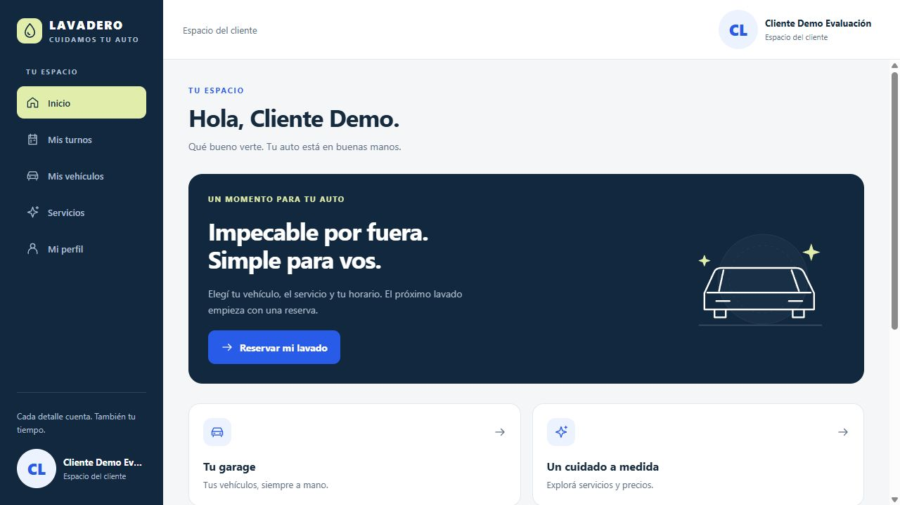

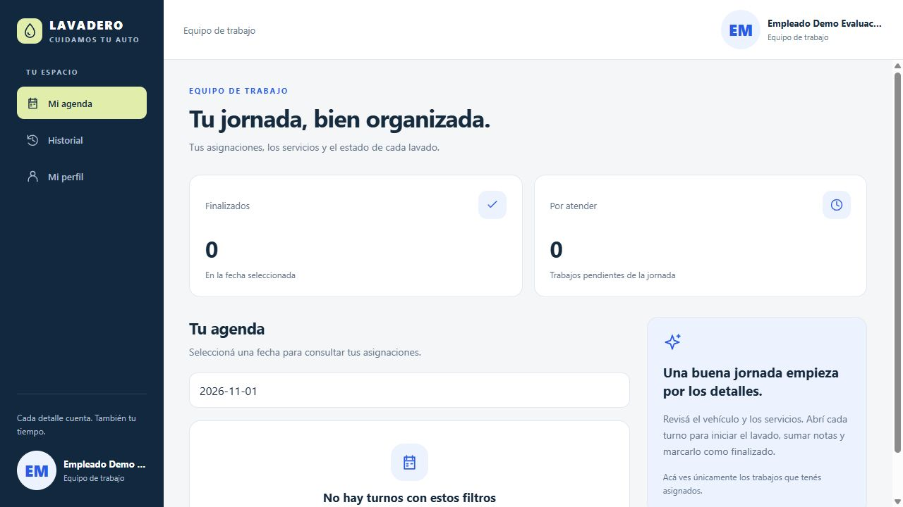

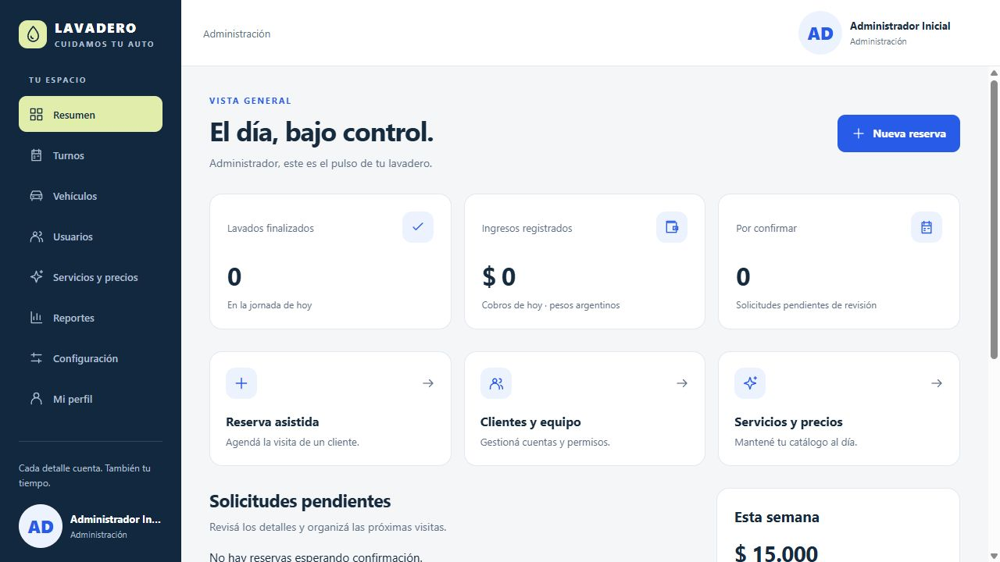

Las capturas funcionales de los recorridos siguientes provienen también de las
pruebas anteriores. Sus controles conservan la función; la apariencia vigente
se muestra en estas portadas. Ver REDISENO-Y-DOCUMENTACION.md para la revisión actual.

## Acceso e instalación

Abrí https://lavadero-app-2558.onrender.com o instalá el APK Android de la entrega.
En Android abrí el archivo descargado y seguí la autorización de instalación que
muestre el dispositivo. El APK funciona sin la computadora ni Metro.
Las credenciales iniciales están en el archivo privado de acceso, separado del código.

Para una cuenta nueva elegí **Creá tu cuenta**, completá nombre, apellido, email,
teléfono opcional y contraseña. La cuenta se crea como Cliente. Un Administrador
puede promoverla después; no existe elección pública de rol.
En el APK, Google, Discord y GitHub abren el navegador del sistema; en web se usa la misma pestaña. Revisá el consentimiento,
autorizá y volvé a la app. Si el correo ya tiene una cuenta con contraseña, confirmala una vez para vincular el mismo perfil. No uses Expo Go para evaluar ese retorno.

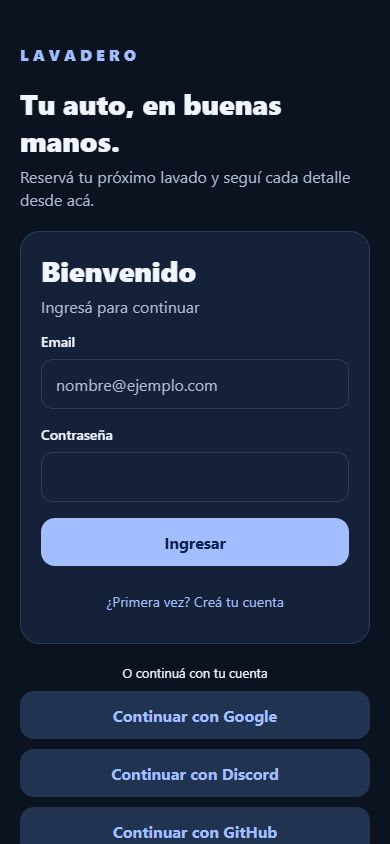

## Cliente

### Vehículos y servicios

Entrá a **Vehículos → Agregar vehículo**. Completá patente única, marca, modelo,
color y tipo. Podés corregir datos desde Editar. Para eliminar, confirmá la baja;
si el vehículo tiene un turno activo, antes debés cancelarlo o finalizarlo.
El borrado conserva el historial. La patente sigue reservada por trazabilidad.

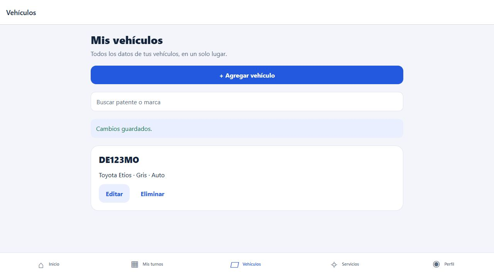

En **Servicios** elegí el tipo de vehículo y consultá descripción, duración y precio.
Los ejemplos duran 30, 35 o 40 minutos; contratar varios suma sus duraciones.
Las tarifas vigentes se consultan por servicio y tipo de vehículo. El administrador las puede cambiar en **Servicios y precios**. Las reservas existentes conservan el precio pactado.

### Reserva y cancelación

En Inicio elegí **Reservar mi lavado**. Seleccioná el tipo de vehículo, el lavado y los extras que quieras, y luego la fecha y el horario. La app muestra el total en pesos argentinos y la duración estimada antes de confirmar. Atención inicial: lunes a sábado 09:30–16:30, un auto a la vez.
Elegí un solo lavado base. El encerado cuesta $15.000 y se combina con exterior o completo. La limpieza de tapizados cuesta $20.000 y también se puede pedir por separado. Para moto solo se ofrece **Lavado** por $15.000, con una duración inicial de 35 minutos.

La grilla propone inicios cada 5 minutos; no implica que cada lavado dure 5 minutos.

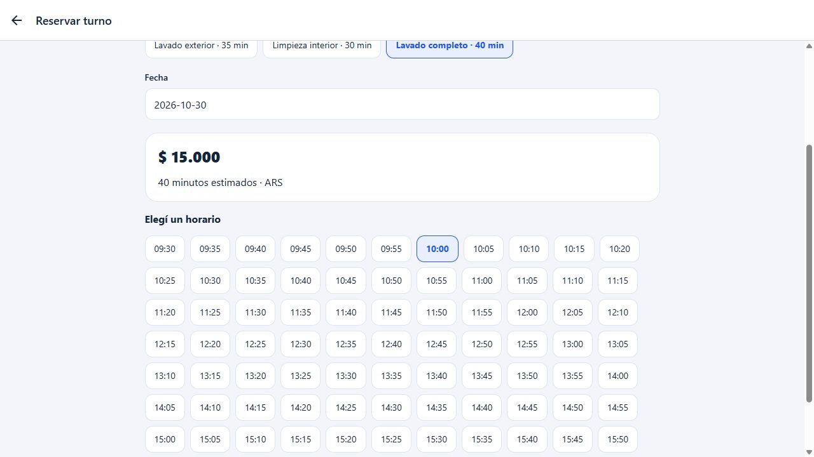

El turno queda **Confirmado** automáticamente y ocupa el horario desde ese momento. En el detalle pulsá **Agregar vehículo al turno** y cargá los datos, o vinculá uno ya registrado del mismo tipo. La agenda muestra la reserva aunque falte vincular el vehículo. Abrí el detalle para ver el empleado asignado y guardar una descripción del vehículo antes de que comience el trabajo. Si todavía no hay un empleado libre, el turno aparece **Por asignar**.
En **Mis turnos** consultá Próximos/Pasados y abrí una tarjeta para ver su detalle.
La cancelación propia está disponible en Pendiente/Confirmado con más de 120 minutos
de anticipación, salvo que el Administrador cambie esa política.
La app actualiza los horarios cada 10 segundos mientras la pantalla de reserva está visible y al volver a ella. Si alguien confirma el mismo horario antes que vos, la app te avisa y vuelve a consultar las opciones. Solo se acepta una reserva para cada hora de inicio.

### Comprobante

Cuando Administración verifica el trabajo aparecen **Ver comprobante** y el formulario de devolución. En **Reclamos y respuestas** podés mandar un reclamo general y consultar la respuesta. Muestra servicios contratados,
precio histórico y cobros registrados. Es comprobante del servicio, no factura fiscal.
También podés consultar las observaciones del trabajo y el saldo.

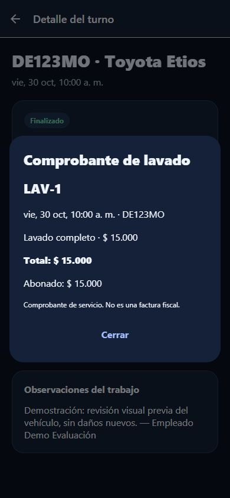

## Empleado

**Mi agenda** abre la fecha actual; cambiá el filtro para otra jornada.
Aparecen todos los turnos del equipo, con vehículo, color, servicios y horario. Buscá por patente para consultar cualquier fecha, o elegí un día para ver la jornada. La agenda se actualiza automáticamente mientras está visible y dispone de Actualizar agenda.
El resumen de jornada distingue finalizados y pendientes. **Historial** muestra trabajos
cerrados. No se ofrecen usuarios, configuración ni reportes de ingresos del negocio.

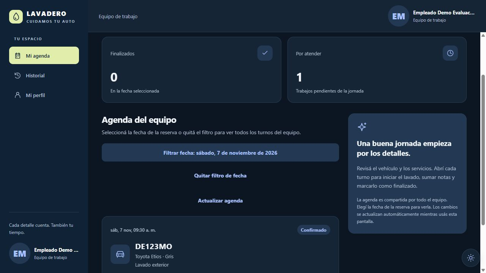

El responsable abre el detalle, pulsa **Comenzar lavado** y carga una descripción de lo que hizo. Durante el horario de atención puede pulsar **Enviar a verificación**. Si Administración lo devuelve, el empleado ve la observación y puede volver a enviarlo después de corregirlo.

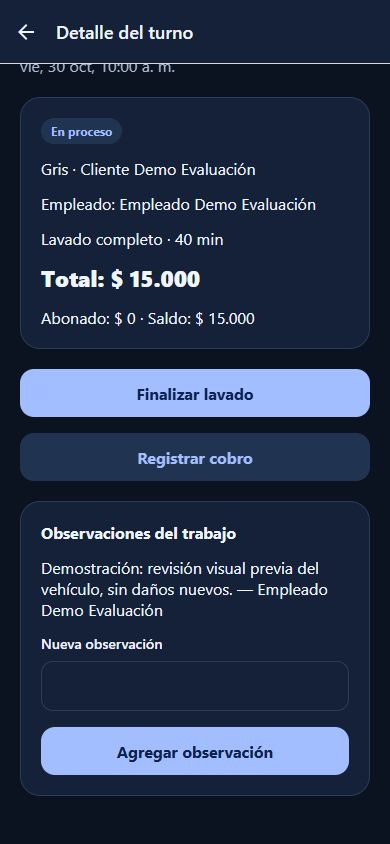

Si un Administrador habilitó tus cobros, aparece **Registrar cobro** durante el trabajo
o al finalizar. Indicá importe en pesos, efectivo/transferencia y referencia opcional.
La app impide superar el saldo y el servidor evita duplicados al reintentar un envío.
Esto registra un pago realizado fuera de la app: no envía ni transfiere dinero.

La pantalla se adapta al girar el dispositivo:

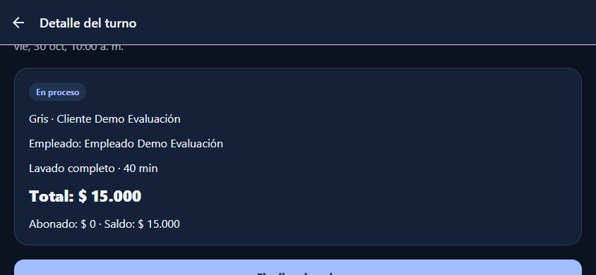

## Administrador

Abrí el menú **☰** para ir a Tablero, Turnos, Usuarios, Servicios y precios,
Reportes, Configuración y Perfil. Desde el tablero también administrás vehículos.

### Usuarios y catálogo

En **Usuarios** buscá por nombre/email o filtrá por rol. Podés crear, editar,
activar/desactivar, asignar rol y habilitar cobros a empleados. La eliminación es lógica.
Cambiar datos administrativos, rol o contraseña puede cerrar sesiones del usuario.
No podés eliminarte, desactivarte ni quitarte el rol; siempre queda un admin activo.

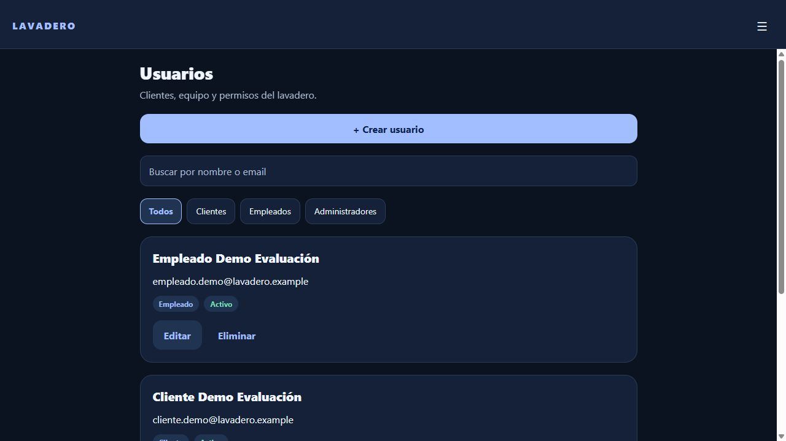

En **Servicios y precios** creá o editá nombre, descripción, duración y disponibilidad.
Usá Precios para definir la tarifa de cada tipo de vehículo. No cambian reservas ya
contratadas. Los tipos se gestionan desde Configuración.

### Turnos, pagos y reportes

En **Turnos** filtrá fecha, estado, cliente y empleado. Podés crear una reserva para
un cliente que llama por teléfono. La reserva se confirma automáticamente para todo el equipo. La app asigna automáticamente a un empleado activo disponible. Podés reasignar antes del inicio. En **Turnos → Lavados por verificar** revisá el parte, inspeccioná el auto y confirmá el trabajo en horario de atención o devolvelo con un motivo.
Podés corregir estados, rechazar/cancelar y registrar observaciones o pagos.

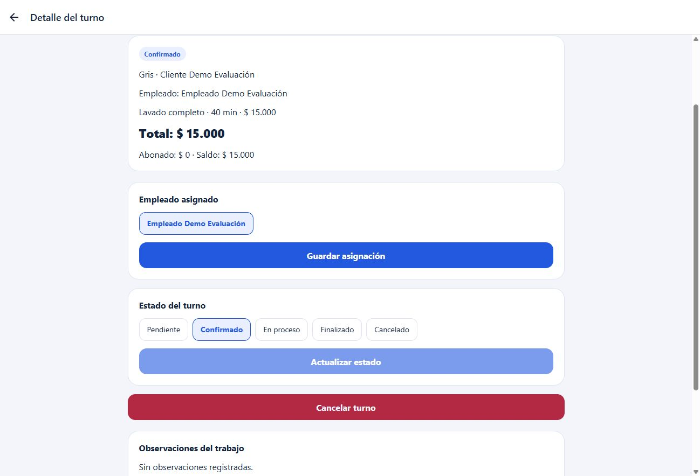

En **Reportes** elegí día, semana o mes y fecha de referencia. Consultá lavados,
ingresos, servicios pedidos y rendimiento. Los ingresos se cuentan por fecha real de
registro del pago; los trabajos por su fecha de atención, por eso pueden diferir.

### Configuración y perfil

La configuración guarda días abiertos, apertura/cierre, capacidad, anticipación para
cancelar y separación de horarios ofrecidos. Los cambios rigen para nuevas reservas;
las existentes conservan su fecha y valores contratados.

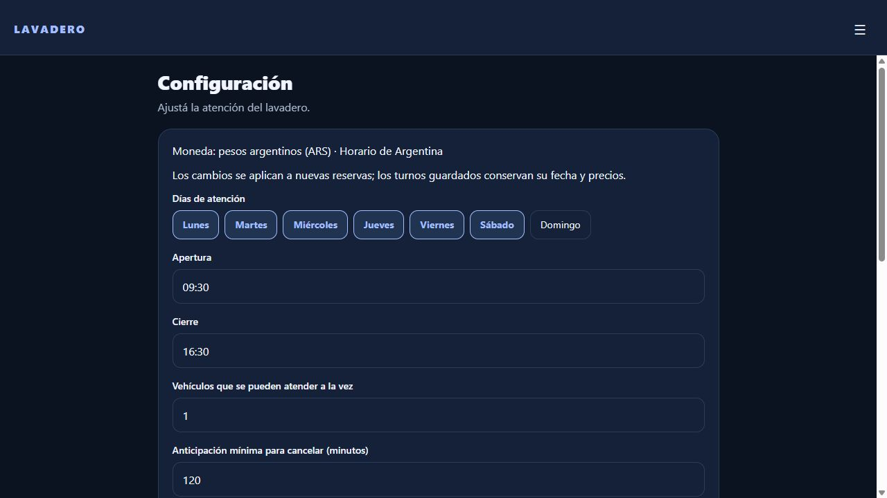

Cada rol dispone de Perfil para nombre, apellido, teléfono y foto mediante enlace HTTPS.
Las cuentas con contraseña local pueden cambiarla indicando la actual. Apariencia permite
seguir el sistema; el botón flotante permite alternar Claro/Oscuro y guarda la elección. Cerrar sesión revoca la sesión del dispositivo.

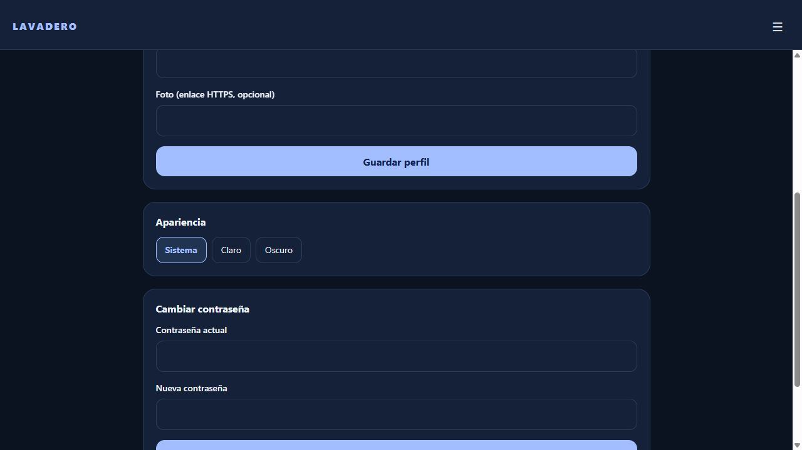

## Demostración y problemas frecuentes

La base incluye Cliente Demo y Empleado Demo, un Toyota Etios DE123MO y un turno/pago
identificados como demostración. El cobro de referencia **DEMO - SIN MOVIMIENTO DE DINERO**
es ficticio. Esos registros permiten evaluar los flujos; no son operaciones del negocio.

- Render Free puede tardar al despertar. Esperá la primera carga y usá Reintentar.
- Sin horarios: revisá fecha, día abierto y duración; varios servicios pueden exceder la jornada.
- Sesión vencida: volvé a ingresar. Cambios de rol/contraseña revocan permisos anteriores.
- Permiso insuficiente o recurso ajeno: ingresá con la cuenta/rol correspondiente.
- Un proveedor social puede tardar en aplicar su configuración; el estado exacto figura en entrega.

## Si usás iPhone

Abrí la versión web en Safari. El APK entregado es para Android; Expo Go no valida el retorno OAuth con scheme propio. Ver PROBAR-EN-IPHONE.md en la entrega o docs/iphone-expo-go.md en el repositorio.

## Controles comunes — versión 1.2.0

El botón de tema flota abajo a la derecha en todas las vistas y diálogos. A su lado aparece Volver arriba solo después de desplazarse en páginas largas. La preferencia se conserva y Perfil permite seguir el sistema.

Tocá tu nombre/avatar arriba a la derecha o abajo a la izquierda en la barra lateral para abrir tu perfil. En teléfono se muestra un avatar compacto en el encabezado.

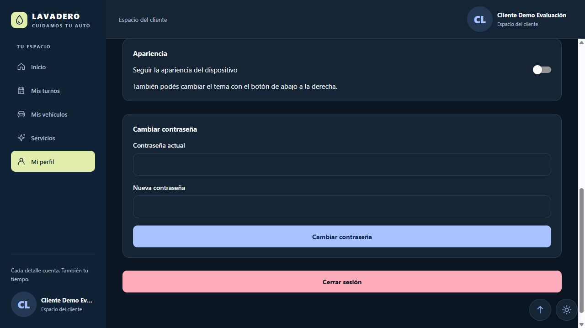

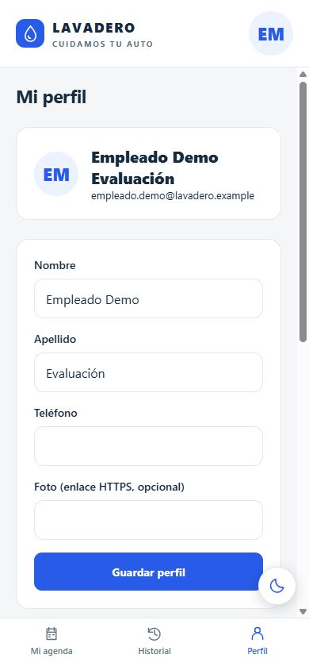

## Atención y asistencia

- En **Reclamos y devoluciones** ves el mensaje, el turno, el responsable y lo que hizo cuando corresponda. **Responder** envía la respuesta al cliente y cierra el caso.
- En **Asistencia** pulsá **Fichar llegada** cuando veas llegar al empleado. Se guarda la primera hora del día y quién hizo el fichaje. Usá la fecha para consultar el historial.
- El personal se registra desde el ingreso. En **Usuarios** buscá su cuenta y editá el rol a **Empleado**. El empleado vuelve a iniciar sesión para entrar a su agenda.

### Tipos de vehículo y tarifas

En **Vehículos**, Administración puede registrar un vehículo para un cliente y crear un tipo con sus tarifas por servicio desde **Agregar tipo y tarifas**. Las tarifas se aplican a los próximos turnos de ese tipo. En **Editar** se pueden ajustar los importes.
