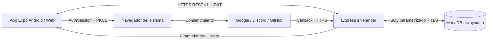

# Arquitectura móvil

Expo Router monta rutas pequeñas que delegan en pantallas. Las pantallas componen
componentes Atomic Design y hooks; los servicios encapsulan el contrato HTTP y Axios.
No se importa código del backend, aunque ambas aplicaciones comparten el mismo repositorio.

`components/atoms` contiene texto/botones/inputs/avatar; `molecules` tarjetas, campos,
notificaciones, filtros simples y paginación; `organisms` formularios, selectores y diálogos.
`hooks` coordina recursos, acciones, paginación y lógica de cada flujo.
`api/services` es la frontera de red; `types` describe DTOs independientes.

AuthContext coordina sesión y restauración; ThemeContext aplica la preferencia persistida.
El interceptor adjunta access JWT y comparte una renovación en curso entre solicitudes.
Una respuesta 401 se reintenta una vez; el control de generación evita restaurar una
sesión que el usuario acaba de cerrar. El backend sigue siendo autoridad sobre permisos.

El navegador de rutas permanece montado durante la restauración. `/loading` evita que
una redirección protegida caiga repetidamente en otra ruta protegida. Cada rol tiene su
grupo de navegación y comparte perfil/detalle mediante componentes comunes.

Formularios RHF + Zod muestran errores por campo. La validación backend vuelve a
comprobar todo. Las listas distinguen carga, vacío, error, paginación y actualización.
En pantallas grandes el contenido tiene ancho máximo; la orientación no se bloquea.

Producción exige una API HTTPS explícita. El arranque local autoriza únicamente loopback de forma explícita; no existe fallback silencioso ni datos falsos. Falta de conexión y proveedores
OAuth no configurados se muestran de forma explícita.

## Mapa del sistema

### Retorno social por plataforma

El APK usa AuthSession con state UUID explícito (el default del SDK es más corto que el contrato backend). Web usa AuthRequest para crear PKCE y redirección en la misma pestaña. El verifier/state temporal expira a los diez minutos y el callback lo valida antes del canje. Los archivos .web seleccionan esa experiencia sin copiar secretos al cliente.
